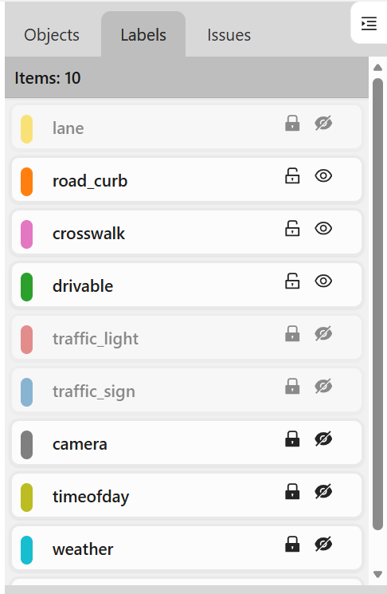
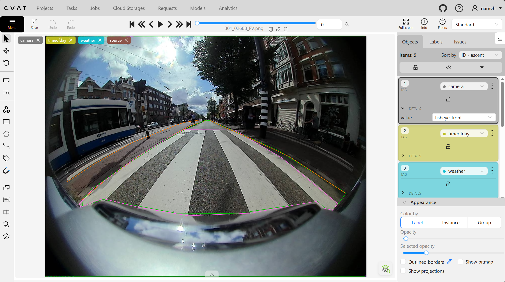
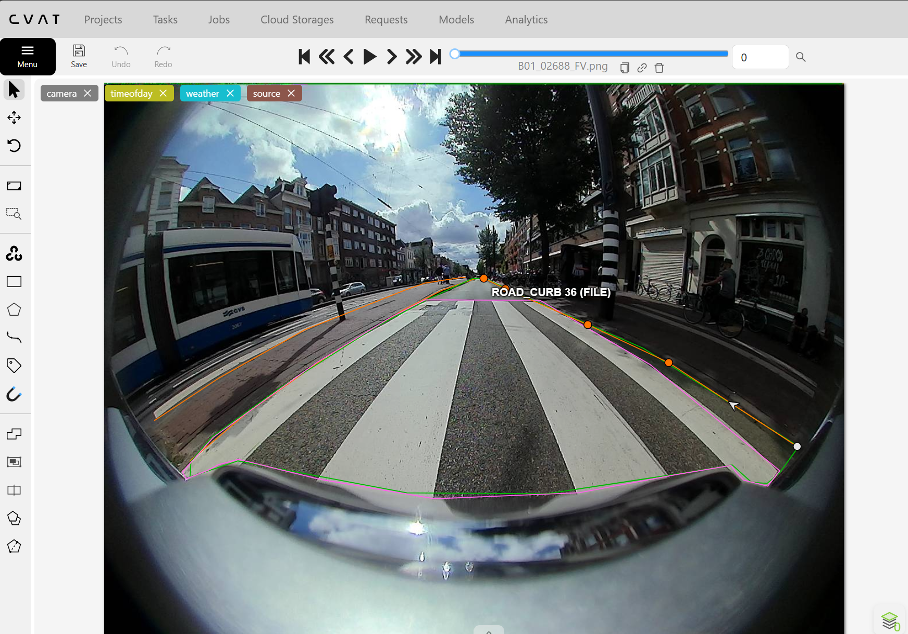
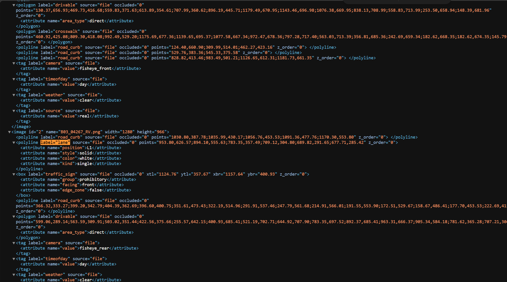

# Báo cáo cá nhân — Ngày 11: Road Elements & SVM

Họ tên: **Vũ Hoàng Nam**  
Mã học viên: **2A202603268**  
Phiên bản CVAT: **chưa có thông tin trong repo**  
Guideline: **Road v1.0** · Lần nộp (`revision`): **1** (theo `nam-manifest.json`)  
Thời điểm tạo manifest: **21/11/2026 01:01:07, giờ Việt Nam** (2026-11-20 18:01:07 UTC).
Số lần nộp lại sau Rework: **0 theo revision hiện có**

## 1. Kiểm project

| Mục | Đúng như Road v1.0? | Ghi chú |
| --- | --- | --- |
| 6 label, đúng kiểu | Có | |
| Thuộc tính và giá trị | Có | |
| 4 tag ảnh | Có | |

Cách kết thúc polyline trên phiên bản CVAT: **nhấn `N`.**  
Cách đặt tag ảnh trên phiên bản CVAT: **vào phần Details rồi chọn tag và giá trị.**

## 2. Số lượng đã gán trong các file export hiện có

| File | Ảnh trong XML | lane | road_curb | crosswalk | drivable | traffic_light | traffic_sign | Tổng shape |
| --- | ---: | ---: | ---: | ---: | ---: | ---: | ---: | ---: |
| `nam-front.zip` | 16 A01–A16 | 41 | 7 | 12 | 37 | 33 | 35 | 165 |
| `nam-fisheye.zip` | 12 B01–B12 | 6 | 26 | 13 | 9 | 5 | 4 | 63 |

## 3. Bảng ca khó và điểm cần rà soát

| Ảnh | Nhãn | Phân vân / cảnh báo | Việc cần làm |
| --- | --- | --- | --- |
| A01, A02 | `lane` | Lint báo thiếu R1 và nhiều polyline cùng `position=L1`; chưa được xác nhận bằng cách xem ảnh/GT. | Mở ảnh, so với guideline và kiểm tra vạch đứt có bị tách thành nhiều đường không. |
| A05, A06, A07, A09, A14 | `lane` | Lint báo thiếu L1/R1. | Kiểm tra ảnh và xin coach xác nhận trường hợp không nhìn thấy vạch. |
| A07 | tags | Thiếu cả `camera`, `timeofday`, `weather`, `source` trong export front. | Bổ sung đủ bốn tag với giá trị đúng rồi export lại. |
| B06–B08, B10 | `lane.position` | Lint báo lane ở camera trái/phải chưa dùng `position=other`. | Tôi sẽ kiểm tra và sửa thuộc tính theo guideline fisheye. |
| B02, B04–B06 | `road_curb`, `traffic_light`, `traffic_sign` | Lint cảnh báo một số polyline fisheye chỉ có 2–3 điểm hoặc box sát rìa có thể cần `edge_zone`. | Tôi sẽ rà từng hình trên ảnh gốc; đây là gợi ý lint cần được xác nhận trực quan. |
| B09, B11 | `road_curb` | Lint báo polyline chỉ có 3 điểm. | Tôi sẽ kiểm tra độ bám theo cung trên ảnh gốc. |
| B10 | `traffic_sign` | Lint gợi ý kiểm tra `edge_zone` cho box sát rìa. | Tôi sẽ đối chiếu vị trí tâm box với guideline. |

## 4. Phiếu QC 1 nhận được

Người kiểm lô của tôi: **Thanh — 2A202603296**. Quyết định cho lô của tôi: **chưa có kết luận QC hợp lệ**.

File `qc1_for_Thanh.md` ghi lô được kiểm là **2A202603296** và người kiểm là **2A202603268**. File này là phiếu tôi lập để kiểm lô của Thanh, không phải phiếu Thanh lập cho lô của tôi; vì vậy tôi không áp dụng quyết định Rework trong phiếu đó cho bài của mình.

| Trạng thái phiếu QC cho lô của tôi | Nội dung |
| --- | --- |
| Người kiểm dự kiến | Thanh — 2A202603296 |
| Phiếu QC nhận được | Chưa có; file hiện có ghi người kiểm và học viên theo chiều ngược lại |
| Quyết định | Chờ phiếu QC đúng lô; chưa kết luận Release / Hold / Rework |

## 5. Kiểm file export

| File | Mở lại được? | Ảnh đầu (job / file) | Ảnh thứ hai (job / file) | Tag camera có trong XML? |
| --- | --- | --- | --- | --- |
| `nam-front.zip` | Có, đọc được `annotations.xml` | A01: 8 shape / 1 bản ghi ảnh trong XML | A02: 6 shape / 1 bản ghi ảnh trong XML | Có trong XML; tổng 15/16 ảnh có tag camera, A07 thiếu |
| `nam-fisheye.zip` | Có, đọc được `annotations.xml` | B01: 5 shape / 1 bản ghi ảnh trong XML | B02: 16 shape / 1 bản ghi ảnh trong XML | Có trong XML; manifest ghi 12/12 ảnh đủ bốn tag |

Đã chạy `road_check lint` trực tiếp trên hai zip mới nhất. Kết quả: **28 bản ghi ảnh, 48 cảnh báo** (13 nặng, 16 chính, 19 nhẹ). Manifest `nam-manifest.json` xác nhận revision 1, cả hai zip không kèm ảnh và số shape nêu ở mục 2. Lint là kiểm tra cấu trúc/gợi ý, không thay cho đối chiếu GT hay quyết định của coach.

## 6. Ảnh chụp màn hình và minh chứng

1. Tab Labels của project: 
2. Ảnh B fisheye đã gán: 
3. Polyline trên ảnh fisheye: 
4. XML có `<polyline label="lane">` và tag: 

## 7. Tự đánh giá

Điểm cần ưu tiên là completeness và kiểm tra export: A07 thiếu tag, một số ảnh bị thiếu L1/R1 theo lint; B06–B08 và B10 cần rà `position=other`, một số `road_curb` fisheye cần kiểm tra điểm theo cung và các box sát rìa cần rà `edge_zone`.

Nhãn đi vào model như dữ liệu giám sát: model học vị trí/hình dạng lane, vùng drivable và thuộc tính đối tượng từ các nhãn này. Nếu thiếu một vạch nhìn thấy được, model có thể học rằng vùng đó không có lane; nếu đặt sai `position` hoặc vẽ lệch, dự đoán lane và ước lượng hướng chạy có thể sai.

## 8. (Tùy chọn) Buffer row-anchor

## 9. Link drive 2 file zip export
https://drive.google.com/drive/folders/1worEzRBNDAZvZZgkZ9LJzaRYOjyz9WoO?usp=sharing
